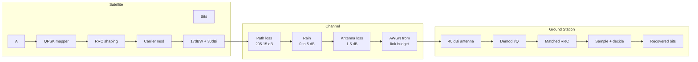

# End-to-End Satellite Downlink Simulation
**Follow a signal 3,.000 km down from orbit and measure exactly what distance and weather do to it.**


---

## The story in 30 seconds
A geostationary satellite sits about 36,000 km above the equator. By the time its signal reaches your dish, it has lost more than **200 dB** of power. The receiver still has to recover every bit from a signal that is far weaker than the noise around it.
This project simulates that whole journey at the physical layer, from random bits to recovered bits. The key design choice: **the link budget drives the channel.** Noise is not a number picked by hand. It is calculated from the system noise temperature and the transmit power, distance and antenna gains.

| 47 dBW | 205.15 dB | 14.18 dB | -1.96 dB |
|:---:|:---:|:---:|:---:|
| EIRP | Path Loss | Clear-sky Eb/N0 | Margin in rain |

</div>

---

### Key results
| Metric | Clear sky | Rain (3.5 dB) |
|---|---|--|
| Total loss | 206.65 dB | 210.15 dB |
| System noise temperature | 150 K | ~302 K |
| **Eb/N0** | **14.18 dB** | **7.64 dB** |
| Margin vs 9.6 dB | **+4.58 dB** | **-1.96 dB** |
| Theoretical BER | 2.33e-13 | 3.28e-04 |

Rain costs **6.54 dB** in total: 3.5 dB of signal attenuation plus about 3 dB from added noise. The link meets its target up to roughly **2.2 dB** of rain fade.

### Weather scenerioes

| Rain | Condition | Eb/N0 | Margin | Theory BER | Sim BER |
|---|---|---|---|---|---|
| 0db | Clear | 14.18 | +4.58 | 2.33e-13 | n/a |
| 1.5 dB | Light | 10.82 | +1.22 | TBD | TBD |
| 3.5 dB | Moderate | 7.64 | -1.96 | 3.28e-04 | TBD |
| 5.0 dB | Heavy | 5.65 | -3.95 | TBD | TBD |

> Eb/N0 and margin are in dB. BERs below about 1e-5 cannot be measured by direct simulation in reasonable time, so they are reported from theory only.

---

## Architecture



---

## How It Works

1. **Map:** Bits are paired into QPSK symbols. The first bit sets the sign of I, the second sets the sign of Q.
2. **Shape:** Symbols are upsampled and filtered with a root-raised-cosine (RRC) pulse, then modulated onto a carrier.
3. **Channel:** The signal is scaled by the link-budget loss. Gausssian noise is added at the Eb/N0 the budget predicts.
4. **Recover:** The receiver demodulates, applies the matched RRC filter, samples once per symbol and decides by sign.
5. **Score:** Errors are counted, skipping the first and last 3 symbols where the filter has not settled.

**Noise Model**

```
Eb/N0 = Prx - 10*log10(k * T_sys * Rb)
T_sys = 150 K + 275 K * (1 - 10^(-A_rain / 10))
```

Rain both weakens the signal and raises the noise floor, so a budget that only subtracts rain loss underestimates the damage.

---

## Specs

| Item | Value |
|---|---|
| Modulation | QPSK, 20 Mb/s (10 Msym/s) |
| Sampling | 100 MHz, 10 samples/symbol |
| Carrier | 10 MHz IF stand-in (budget uses 12 GHZ) |
| Pulse Shaping | RRC, beta 0.35, span 6 symbols |
| Distance | 36,000 km (GEO) |
| EIRP | 47 dBW (17 dBW + 30 dBi) |
| Receive Gain | 40 dBi |
| Antenna / pointing loss | 1.5 dB |
| Required Eb/N0 | 9.6 dB (uncoded QPSK, BER 1e-5) |

---

## Validation 

- Simulated BER tracks the theoretical curve across the Eb/N0 sweep.
- **0 errors** at 40 dB Eb/N0, confirming timing and filter alignment.
- Eb/N0 values match hand calculations of the link budget.

---

<details>
  <summary><b>How I built it</b></summary>

  <br>

Built one stage at a time, each tested before the next:

1. **Theory first:** QPSK, I/Q, constellations, SNR, link budgets, pulse shaping, matched filtering, ISI and RRC design.
2. **Transmitter, channel, receiver**, then a BER sweep against theory.
3. **Realism pass:** 12GHz budget, 40 dBi antenna, noise from system temperature, and finally rain-induced sky noise.
4. **Debugging against theory.** Real bugs found and fixed:
   - the receiver sampled between symbols, not at the filter peak
   - the RRC filter had uneven tap spacing that shifted its peak
   - the BER-curve transmitter used a different pulse than the main one
   - filter edge effects inflated the error count
   - typos and missing semicolons that stopped the script

**Tools:** GNU Via Octave Online, no toolboxes. Theory uses `erfc` instead of `qfunc`,  so no communication package is needed.

</details>

<details>
  <summary><b>Model vs A Real Satellite</summary>

    <br>
| This Model | A Real System |
|---|---|
| Perfect carrier and timing sync | Costas loop / PLL, timing recovery |
| Uncoded QPSK | LDPC/BCH or convolution coding |
| Fixed 36,000 km | Could be more |
| Linear amplifier | Non linear TWTA with back-off |
</details>

---

## Roadmap

- [ ] Carrier phase/frequency offset with Costas-loop recovery
- [ ] Forward error correction and coded-BER comparison
- [ ] Rain sweep: Eb/N0 vs rain attenuation
- [ ] Link-margin recovery study (dish size, power, coding)
- [ ] 8-PSK / 16-QAM comparison, PSD, eye diagram, EVM
- [ ] Python port with an ML modulation/noise classifer

---

## Quick Start

Needs GNU Octave or [Octave Online](https://octave-online.net).

```bash
git clone https://github.com/<pjiya304-bot>/<End-to-End-Satellite-downlink-simulation>.git
```

Run the scripts in `src/` in order: transmitter, channel, receiver, BER curve. Change the weather with one line:

```matlab
rain_loss_db = 3.5;   % 0 clear, 105 light, 3.5 moderate, 5 heavy
```

Set `num_bits = 100000` for a measurable BER at 3.5 dB.

```

.
|-- src/              transmitter, channel, receiver, BER curve
|-- docs/figures/     constellations, waveforms, BER curve
|-- docs/report.pdf   IEEE-format report
|-- README.md
```

---

## License

MIT
