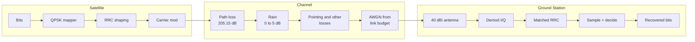

# End-to-End Satellite Downlink Simulation
**Follow a signal 36,000 km down from orbit and measure exactly what distance and weather do to it.**


---

## The story in 30 seconds
A geostationary satellite sits about 36,000 km above the equator. By the time its signal reaches the ground, it has lost more than **200 dB** of power and arrives at roughly a picowatt. The receiver still has to recover every bit from that faint signal.
This project simulates that whole journey at the physical layer, from random bits to recovered bits. The key design choice: **the link budget drives the channel.** The signal is scaled to the received power in watts and the noise is generated from kTB using the system noise temperature. Eb/N0 is then **measured from the simulated waveforms** and compared with the budget, so the simulation can genuinely disagree with the calculation.

The script ships with a 4dB rain-fade scenario as its default and clear sky is one line away (rain_loss_dB = 0).

|  | Clear sky | 4 dB rain (default) |
|:---:|:---:|:---:|
| Total loss | 206.57 dB | 210 dB |
| Received power | -119.57 dBW | -123.57 dBW |
| Eb/N0 (budget/simulated) | 14.26/14.20 dB | 7.03/6.97 dB |
| Link margin | +3.16 dB | -4.07 dB |
| Theoretical BER | 2.0e-13 | 8.0e-4 |
| Simulated BER | 0 errors in 7,994 bits | 1.13e-3 (9 errors in 7,994 bits) |

</div>

---

### Key results
| Metric | Value | 
|---|---|
| EIRP | 47 dBW |
| Slant range ( 40 deg elevation ) | 37,780 km |
| Free-space path loss | 205.57 dB |
| Other losses ( gas, pointing, polarization ) | 1.0 dB |
| Total loss | 206.57 dB |
| Received antenna gain | 40 dBi |
| Received power | -119.57 dBW (about 1.1 pW) |
| System noise temperature | 150 K |
| G/T | 18.24 dB/K |
| C/N0 | 87.21 dB-Hz |
| Eb/N0 (budget/measured in simulation) | 14.26 dB/ 14.20 dB |
| Required Eb/N0 (uncoded QPSK, BER 1e-5) | 9.6 dB |
| Demodulator implementation loss | 1.5 dB |
| Link margin | +3.16 dB |
| Theoretical BER at 14.2 dB | 2.0e-13 |
| Simulated errors | 0 of 7,994 bits (expected: too few bits to see 1e-13) |

---

## Architecture



---

## How It Works

1. **Map:** random bits are paired into QPSK symbols. The first bit sets the sign of I, the second sets the sign of Q.
2. **Shape:** symbols are upsampled (10 samples/symbol) and filtered with a root-raised-cosine (RRC) pulse, then modulated onto orthogonal cosine and sine carriers.
3. **Channel:** the unit-power waveform is scaled to the received power from the link budget. Thermal noise is generated from kTB. Eb/N0, Es/N0, C/N0 and SNR are measured from the actual waveforms and compared with the budget.
4. **Recover:** the receiver demodulates with a local oscillator that has a 25 degree phase error, applies the matched RRC filter, samples once per symbol, and removes the phase error with a second-order Costas loop. Bits are decided by sign.
5. **Score:** errors are counted after the first 1,000 symbols (loop lock time) and excluding the last 3 symbols (filter edge).
6. **Validate:** a separate BER sweep (0 to 8 dB, at least 100 errors per point) is compared with the QPSK theory curve, and the link's operating point is drawn on it.


## Link Budget
> 1. EIRP = P_tx + G_tx = 17 dBW + 30 dBi = 47 dBW
> 2. d    = -Re*sin(el) + sqrt((Re*sin(el))^2 + h^2 + 2*Re*h)   (GEO slant height)
> 4. FSPL = 20*log10(4*pi*d*f / c) 
> 5. P_rx = EIRP - G_rx - FSPL - L_rain - L_gas - L_pointing - L_pol
> 6. T_sys = 150 K + 275 K * (1 - 10^(-A_rain/10))
> 7. G?T = G_rx - 10*log10(T_sys)
> 8. C/N0 = P_rx - 10*log10(k * T_sys)
> 9. Eb/N0 = P_rx - 10*log10(k * T_sys * Rb)
> 10. Margin = Eb/N0 - L_impl - 9.6 dB

**EIRP** (effective isotropic radiated power) is transmit power plus transmit antenna gain. It is the power an ideal antenna radiating equally in all directions would need ot match the satellite's signal in the direction of its main beam.

---

## Specs

| Item | Value |
|---|---|
| Modulation | QPSK, 20 Mb/s (10 Msym/s) |
| Sampling | 100 MHz, 10 samples/symbol |
| Carrier | 10 MHz IF stand-in (budget uses 12 GHZ) |
| Pulse Shaping | RRC, roll-off 0.35, span 6 symbols |
| Occupied bandwidth | about 13.5 MHz |
| Geometry | GEO altitude 35,786 km, 40 degree elevation, slant range 37,780 km |
| EIRP | 47 dBW |
| Received gain | 40 dBi |
| System temperature | 150 k clear sky, raises with rain |
| Losses | gas 0.2 dB, pointing 0.5 dB, polarization 0.3 dB, rain 0 to 5 dB; implementation loss 105 dB (margin only) |
| Costas loop gain | alpha = 0.03, beta_1 = 0.0005 |
| Required Eb/N0 | 9.6 dB (uncoded QPSK, BER 1e-5) |

---

## Validation 

- Simulated BER lies on the theoretical QPSK curve from 0 to 8 dB, with atleast 100 errors per point.
- Budget and measured EB/N0 agree within 0.06 dB in both clear sky (14.26 vs 14.20 dB) and 4 dB rain (7.03 vs 6.97 dB).
- The Costas loop recovers a 25 degree phase offset: the before/after constellations and the phase estimate settle at about -25 degrees.
- In the 4 dB rain run, 9 errors in 7,994 bits is consistent with the theoretical 8.0e-4.

---

</details>

<details>
  <summary><b>Model vs A Real Satellite</summary>

    
Model vs a Real Satellite
> 1. **Perfect symbol timing.** The receiver samples at exact instant. A real receiver needs timing recovery (for example Gardener).
> 2. **No amplifier nonlinearity**. Real satellite TWTAs compress and distort the signal.
> 3. No **phase noise** on either oscillator and no doppler or frequency offset in the default run.
> 4. No **forward error correction**. Real links use LDPC or convolutional codes and work far below 9.6 dB.
> 5. **Costas phase ambiguity.** A QPSK Costas loop can lock 90, 180, 270 degrees away from the true phase. It locks correctly here because the offset is under 45 degrees. Real systems use a preamble or differential coding.
> 6. **The BER sweep uses an ideal receiver** (no phase offset, no Costas loop) and sets noise from the swept Eb/N0, so it validates the modulator, filters and decision rule rather than the carrier recovery.
> 7. **Carrier.** The simulation runs at a 10 MHz IF, standing in for 12 GHz. The modulation maths is the same.
</details>

---

## Roadmap

- [ ] Carrier phase/frequency offset with Costas-loop recovery
- [ ] Fade scenarios
- [ ] Symbol timing recovery 
- [ ] Forward error correction and coded-BER comparison
- [ ] Fade sweep: Eb/N0 vs attenuation
- [ ] Link-margin recovery study (dish size, power, coding)
- [ ] 8-PSK / 16-QAM comparison, PSD, eye diagram, EVM
- [ ] Python port with an ML modulation/noise classifer

---

## Quick Start

Needs GNU Octave or [Octave Online](https://octave-online.net).

```bash
git clone https://github.com/pjiya304-bot/End-to-End-Satellite-downlink-simulation.git
cd End-to-End-Satellite-downlink-simulation
```

Run the scripts in `src/` in order: transmitter, channel, receiver, BER curve. Change the weather with one line:

```matlab
rain_loss_db = 4;   % 0 clear, 1.5 light, 3.5 moderate, 4 heavy, 5 severe
```

---

## License

MIT
