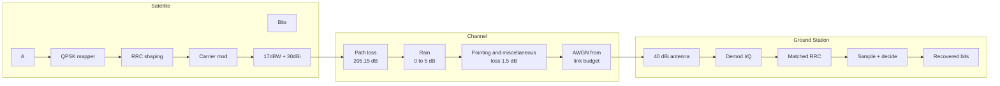

# End-to-End Satellite Downlink Simulation
**Follow a signal 36,000 km down from orbit and measure exactly what distance and weather do to it.**


---

## The story in 30 seconds
A geostationary satellite sits about 36,000 km above the equator. By the time its signal reaches the ground, it has lost more than **200 dB** of power and arrives at roughly a picowatt. The receiver still has to recover every bit from that faint signal.
This project simulates that whole journey at the physical layer, from random bits to recovered bits. The key design choice: **the link budget drives the channel.** The signal is scaled to the received power in watts and the noise is generated from kTB using the system noise temperature. Eb/N0 is then **measured from the simulated waveforms** and compared with the budget, so the simulation can genuinely disagree with the calculation.

| 47 dBW | 205.57 dB | 14.26 dB | +3.16 dB |
|:---:|:---:|:---:|:---:|
| EIRP | Path Loss | Clear-sky Eb/N0 | Link Margin |

</div>

---

### Key results
| Metric | Value | 
|---|---|
| EIRP | 47 dBW |
| Slant range ( 40 deg elevation ) | 37,780 km |
| Free-space path loss | 205.57 dB |
| Other losses ( gas, pointing, polarization ) | 1.0 dB |
| Total loss | 206.57 dB |
| Received antenna gain | 40 dBi |
| Received power | -119.57 dBW (about 1.1 pW) |
| System noise temperature | 150 K |
| G/T | 18.24 dB/K |
| C/N0 | 87.21 dB-Hz |
| Eb/N0 (budget/measured in simulation) | 14.26 dB/ 14.20 dB |
| Required Eb/N0 (uncoded QPSK, BER 1e-5) | 9.6 dB |
| Demodulator implementation loss | 1.5 dB |
| Link margin | +3.16 dB |
| Theoretical BER at 14.2 dB | 2.0e-13 |
| Simulated errors | 0 of 7,994 bits (expected: too few bits to see 1e-13) |

---

## Architecture



---

## How It Works

1. **Map:** random bits are paired into QPSK symbols. The first bit sets the sign of I, the second sets the sign of Q.
2. **Shape:** symbols are upsampled (10 samples/symbol) and filtered with a root-raised-cosine (RRC) pulse, then modulated onto orthogonal cosine and sine carriers.
3. **Channel:** the unit-power waveform is scaled to the received power from the link budget. Thermal noise is generated from kTB. Eb/N0, Es/N0, C/N0 and SNR are measured from the actual waveforms and compared with the budget.
4. **Recover:** the receiver demodulates with a local oscillator that has a 25 degree phase error, applies the matched RRC filter, samples once per symbol, and removes the phase error with a second-order Costas loop. Bits are decided by sign.
5. **Score:** errors are counted after the first 1,000 symbols (loop lock time) and excluding the last 3 symbols (filter edge).
6. **Validate:** a separate BER sweep (0 to 8 dB, at least 100 errors per point) is compared with the QPSK theory curve, and the link's operating point is drawn on it.


## Link Budget
> 1. EIRP = P_tx + G_tx = 17 dBW + 30 dBi = 47 dBW
> 2. d    = -Re*sin(el) + sqrt((Re*sin(el))^2 + h^2 + 2*Re*h)   (GEO slant height)
> 4. FSPL = 20*log10(4*pi*d*f / c) = 205.15 dB (d = 36,000 km, f = 12 GHz)
> 5. P_rx = EIRP - FSPL - L_misc +G_rx = -119.65 dBW
> 6. EB/N0 = P_rx - 10*log10(k * T_sys * Rb)

**EIRP** (effective isotropic radiated power) is transmit power plus transmit antenna gain. It is the power an ideal antenna radiating equally in all directions would need ot match the satellite's signal in the direction of its main beam.

## Weather Sensitivity
Extra fade does two things: it weakens the signal and it raises the receiver's noise floor, so a budget that only subtracts the fade underestimates the damage.

T_sys = 150 K + 275 K * (1-10^(-A_fade / 10))

| Fade | Condition | Eb/N0 | Margin | Theory BER | Sim BER |
|---|---|---|---|---|---|
| 0 dB | Clear | 14.18 | +4.58 | 2.33e-13 | n/a |
| 1.5 dB | Light | 10.82 | +1.22 | ~4.5e-07 | n/a |
| 3.5 dB | Moderate | 7.64 | -1.96 | 3.28e-04 | TBD |
| 5.0 dB | Heavy | 5.65 | -3.95 | ~3.4e-03 | TBD |

The link meets its target up to roughly 2.2 dB of fade. Eb/N0 and margin are in dB. BERs below about 1e-5 cannot be measured by direct simulation in reasonable time, so they are reported from theory only.

---

## Specs

| Item | Value |
|---|---|
| Modulation | QPSK, 20 Mb/s (10 Msym/s) |
| Sampling | 100 MHz, 10 samples/symbol |
| Carrier | 10 MHz IF stand-in (budget uses 12 GHZ) |
| Pulse Shaping | RRC, beta 0.35, span 6 symbols |
| Distance | 36,000 km (GEO) |
| EIRP | 47 dBW (17 dBW + 30 dBi) |
| Receive Gain | 40 dBi |
| Pointing and misc. loss(including atmospheric gases) | 1.5 dB |
| Weather fade scenarios | 0 to 5 dB |
| Required Eb/N0 | 9.6 dB (uncoded QPSK, BER 1e-5) |

---

## Validation 

- Simulated BER tracks the theoretical curve across the Eb/N0 sweep.
- **0 errors** at 40 dB Eb/N0, confirming timing and filter alignment.
- Eb/N0 values match hand calculations of the link budget.

---

<details>
  <summary><b>How I built it</b></summary>

  <br>

Built one stage at a time, each tested before the next:

1. **Theory first:** QPSK, I/Q, constellations, SNR, link budgets, pulse shaping, matched filtering, ISI and RRC design.
2. **Transmitter, channel, receiver**, then a BER sweep against theory.
3. **Realism pass:** 12GHz budget, 40 dBi antenna, noise from system temperature, and finally sky noise.
4. **Debugging against theory.** Real bugs found and fixed:
   - the receiver sampled between symbols, not at the filter peak
   - the RRC filter had uneven tap spacing that shifted its peak
   - the BER-curve transmitter used a different pulse than the main one
   - filter edge effects inflated the error count
   - typos and missing semicolons that stopped the script

**Tools:** GNU Octave (via Octave Online), no toolboxes. Theory uses `erfc` instead of `qfunc`,  so no communication package is needed.

</details>

<details>
  <summary><b>Model vs A Real Satellite</summary>

    <br>
| This Model | A Real System |
|---|---|
| Perfect carrier and timing sync | Costas loop / PLL, timing recovery |
| Uncoded QPSK | LDPC/BCH or convolution coding |
| Fixed 36,000 km | Slant range varies with ground-station location | |
| Gas absorption folded into the fixed 105 dB loss | Separate oxygen and water vapour loss |
| Linear amplifier | Non linear TWTA with back-off |
</details>

---

## Roadmap

- [ ] Carrier phase/frequency offset with Costas-loop recovery
- [ ] Forward error correction and coded-BER comparison
- [ ] Fade sweep: Eb/N0 vs attenuation
- [ ] Link-margin recovery study (dish size, power, coding)
- [ ] 8-PSK / 16-QAM comparison, PSD, eye diagram, EVM
- [ ] Python port with an ML modulation/noise classifer

---

## Quick Start

Needs GNU Octave or [Octave Online](https://octave-online.net).

```bash
git clone https://github.com/pjiya304-bot/End-to-End-Satellite-downlink-simulation.git
cd End-to-End-Satellite-downlink-simulation
```

Run the scripts in `src/` in order: transmitter, channel, receiver, BER curve. Change the weather with one line:

```matlab
rain_loss_db = 3.5;   % 0 clear, 1.5 light, 3.5 moderate, 5 heavy
```

Set `num_bits = 100000` for a measurable BER at 3.5 dB.

```

.
|-- src/              transmitter, channel, receiver, BER curve
|-- docs/figures/     constellations, waveforms, BER curve
|-- docs/report.pdf   IEEE-format report
|-- README.md
```

---

## License

MIT
